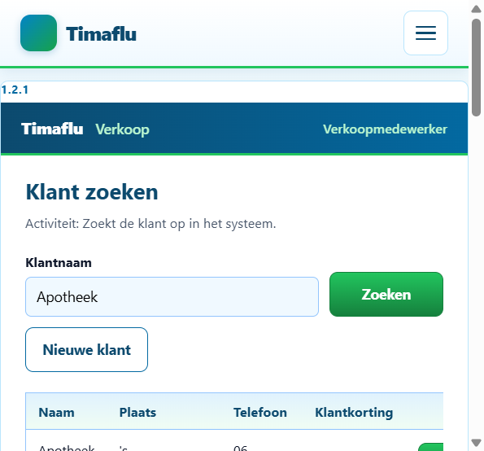
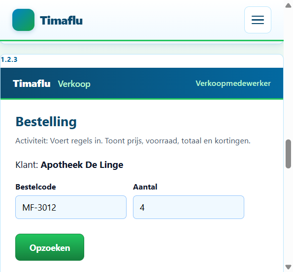
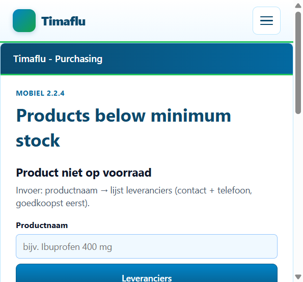
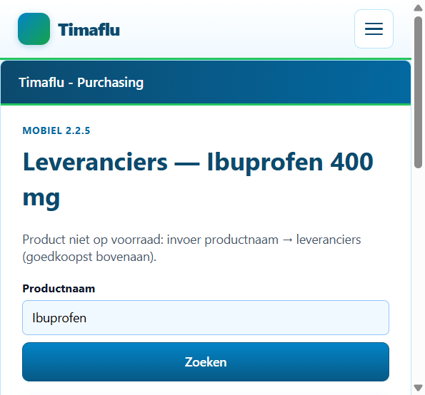
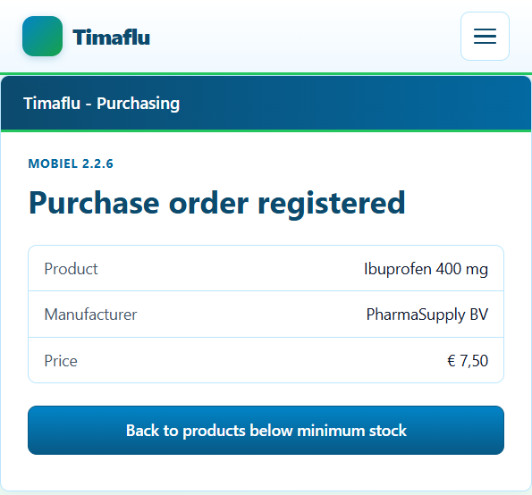
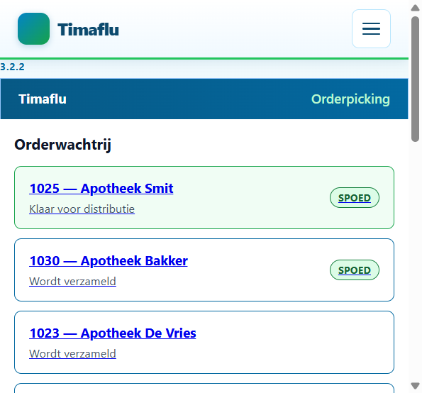
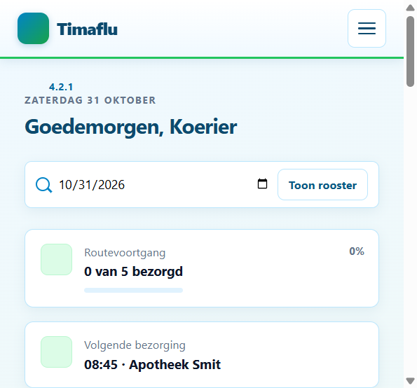
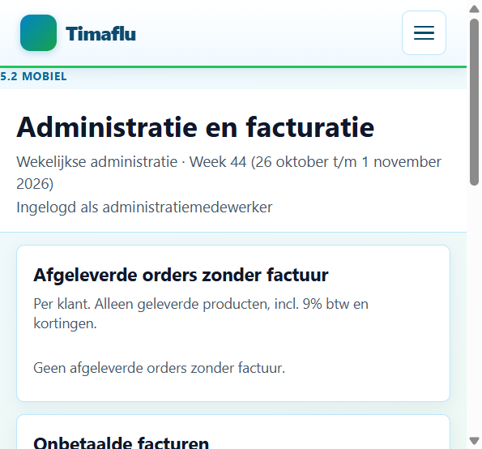
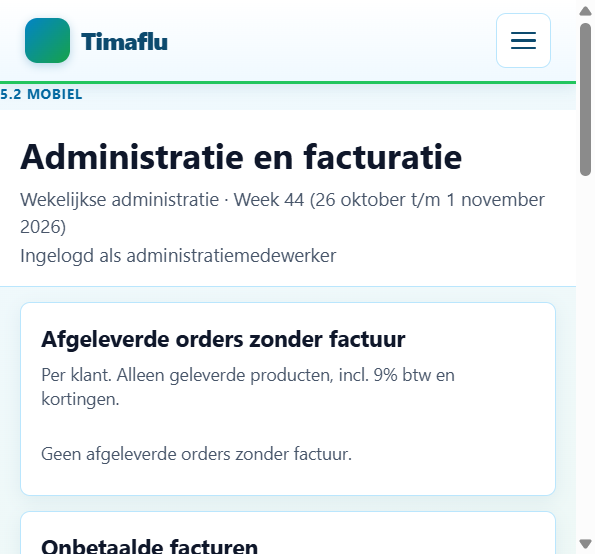
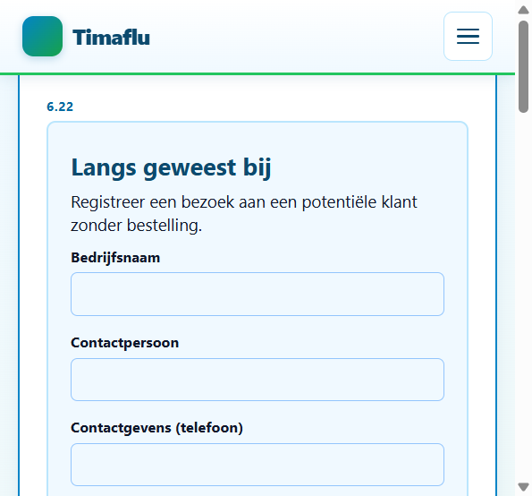

# Timaflu — Schermen, queries en output

**Groep D** · Database `timaflu` · Flask-app `Backend/templates/`

Dit document bevat **alle schermen** van de applicatie, de **SQL-queries** die dat scherm vullen, en de **volledige query-output** uit MySQL. De output is groot genoeg om te laten zien dat de query het juiste resultaat teruggeeft.

Bronnen:

- Schema/seed: `timaflu_schema.sql`, `timaflu_seed.sql`
- Queries komen 1-op-1 uit de services in `Backend/services/`
- Schermafbeeldingen: live app op 1 november 2026 (`http://127.0.0.1:5000/`)

---

## Overzicht

| # | Proces | Scherm | Template | Hoofdtabellen |
|---|--------|--------|----------|---------------|
| 1.2.1 | Verkoop | Klant zoeken | `index.html` | `customer`, `address` |
| 1.2.2 | Verkoop | Klant | `index.html` | `customer`, `address`, `orders`, `order_line` |
| 1.2.3 | Verkoop | Bestelling | `index.html` | `product` |
| 1.2.4 | Verkoop | Afronden | `index.html` | `orders`, `order_line`, `customer` |
| 2.2.1 | Inkoop | Products below minimum stock | `inkoop-2-2-1.html` | `product` |
| 2.2.2 | Inkoop | Leveranciers (goedkoopst eerst) | `inkoop-2-2-2.html` | `product`, `product_supplier`, `manufacturer` |
| 2.2.3 | Inkoop | Purchase order registered | `inkoop-2-2-3.html` | `purchase_order` |
| 3.2.1 | Orderpicking | Wachtrij + orderdetail | `orderpicking.html` | `orders`, `order_line`, `product`, `order_pick_gang` |
| 4.2.1 | Distributie | Bezorgrooster | `distributie.html` | `delivery`, `orders`, `customer`, `address` |
| 5.2 | Administratie | Facturatie | `administratie.html` | `invoice`, `orders`, `order_line`, `customer` |
| 6.22 | Acquisitie | Bezoek + overzicht + follow-up | `acquisition-6-22.html` | `visit`, `visit_follow_up`, `customer` |

---

## 1. Verkoop

### 1.2.1 Klant zoeken

De verkoopmedewerker zoekt op (deel van) de klantnaam. Het scherm toont alle 8 apotheken bij zoekterm `Apotheek`, met plaats, telefoon en klantkorting.



**Query** (`VerkoopService.search_customers`):

```sql
SELECT c.customer_id AS klantnummer,
       c.company_name AS bedrijfsnaam,
       c.contact_person AS contactpersoon,
       c.phone_number AS telefoonnummer,
       a.city AS aflever_plaats,
       c.annual_turnover AS jaaromzet_vast,
       c.one_time_discount AS eenmalige_korting,
       c.blocked AS incassoblokkade
FROM customer c
JOIN address a ON a.address_id = c.delivery_address_id
WHERE c.company_name LIKE '%Apotheek%'
   OR c.contact_person LIKE '%Apotheek%'
ORDER BY c.company_name;
```

**Output (8 rijen — alle klanten in de seed):**

| klantnummer | bedrijfsnaam | contactpersoon | telefoonnummer | aflever_plaats | jaaromzet_vast | eenmalige_korting | incassoblokkade |
|-------------|--------------|----------------|----------------|----------------|----------------|-------------------|-----------------|
| 8 | Apotheek Bakker | Nora Bakker | 06-77889900 | 's-Hertogenbosch | 11000.00 | 0 | 0 |
| 2 | Apotheek Centrum | Mark van Dijk | 06-22334455 | 's-Hertogenbosch | 8000.00 | 0 | 0 |
| 1 | Apotheek De Linge | Sanne Visser | 06-11223344 | Oss | 15000.00 | 1 | 0 |
| 5 | Apotheek De Vries | Jan de Vries | 076-5123456 | Breda | 15000.00 | 0 | 0 |
| 7 | Apotheek Jansen | Tom Jansen | 06-66778899 | Oss | 9000.00 | 0 | 0 |
| 3 | Apotheek Noord | Lisa Jansen | 06-33445566 | 's-Hertogenbosch | 22000.00 | 0 | 0 |
| 6 | Apotheek Smit | Emma Smit | 06-55667788 | 's-Hertogenbosch | 6000.00 | 0 | 0 |
| 4 | Apotheek Zuid | Peter Bakker | 06-44556677 | 's-Hertogenbosch | 12000.00 | 0 | 1 |

De `LIKE '%Apotheek%'` filtert correct: alle 8 rijen hebben “Apotheek” in de bedrijfsnaam. Apotheek Zuid heeft `incassoblokkade = 1`; de rest niet. De JOIN op `address` levert de plaats (Oss / Breda / 's-Hertogenbosch).

---

### 1.2.2 Klant

Na **Kies** toont het scherm de geselecteerde klant (hier Apotheek De Linge), aflever- en betaaladres, en de berekende klantkorting op basis van de jaaromzet.



**Query A — klant + adressen** (`get_customer`):

```sql
SELECT c.customer_id AS klantnummer,
       c.company_name AS bedrijfsnaam,
       c.contact_person AS contactpersoon,
       c.phone_number AS telefoonnummer,
       c.region AS regio,
       c.annual_turnover AS jaaromzet_vast,
       c.one_time_discount AS eenmalige_korting,
       c.blocked AS incassoblokkade,
       CONCAT(da.street, ' ', da.house_number, ', ', da.postal_code, ' ', da.city) AS afleveradres,
       CONCAT(ia.street, ' ', ia.house_number, ', ', ia.postal_code, ' ', ia.city) AS betaaladres
FROM customer c
JOIN address da ON da.address_id = c.delivery_address_id
JOIN address ia ON ia.address_id = c.invoice_address_id
WHERE c.customer_id = 1;
```

**Output:**

| klantnummer | bedrijfsnaam | contactpersoon | telefoonnummer | regio | jaaromzet_vast | eenmalige_korting | incassoblokkade | afleveradres | betaaladres |
|-------------|--------------|----------------|----------------|-------|----------------|-------------------|-----------------|--------------|-------------|
| 1 | Apotheek De Linge | Sanne Visser | 06-11223344 | Oss | 15000.00 | 1 | 0 | Lindelaan 12, 5341 AB Oss | Lindelaan 12, 5341 AB Oss |

**Query B — werkelijke jaaromzet uit orderregels** (lopend kalenderjaar):

```sql
SELECT COALESCE(SUM(ol.quantity * ol.price), 0) AS jaaromzet
FROM orders o
JOIN order_line ol ON ol.order_id = o.order_id
WHERE o.customer_id = 1
  AND YEAR(o.order_date) = YEAR(CURDATE());
```

**Output:**

| jaaromzet |
|-----------|
| 857.50 |

Dit is de som van de 2026-orders van De Linge (order 1: 20 × 12,50 + 20 × 12,50 = 500,00 en order 9: 15 × 12,50 + 20 × 8,50 = 357,50). De query telt order 8 uit 2025 niet mee, dus het jaardfilter werkt.

---

### 1.2.3 Bestelling

De medewerker zoekt een product op bestelcode. Het scherm toont naam, prijs, minimum en voorraad. Voorbeeld: `MF-3012` (Amoxicilline 500 mg).

**Query — product op bestelcode** (`get_medicijn`):

```sql
SELECT product_id,
       order_code AS bestelcode,
       name AS naam,
       stock AS voorraad,
       minimum_stock AS minimum_voorraad,
       packaging_type AS magazijn_locatie,
       price_per_bulk_pack AS prijs,
       minimum_order_qty AS minimum_bestel,
       short_description AS omschrijving
FROM product
WHERE order_code = 'MF-3012';
```

**Output:**

| product_id | bestelcode | naam | voorraad | minimum_voorraad | magazijn_locatie | prijs | minimum_bestel | omschrijving |
|------------|------------|------|----------|------------------|------------------|-------|----------------|--------------|
| 3 | MF-3012 | Amoxicilline 500 mg | 41 | 30 | Loc A12 | 18.75 | 1 | Antibioticum |

Exact één rij op unieke bestelcode. Voorraad 41 ≥ minimum 30, dus het product is leverbaar.

**Query — volledig assortiment** (ter controle dat de producttabel gevuld is):

```sql
SELECT product_id, order_code AS bestelcode, name AS naam,
       stock AS voorraad, minimum_stock AS minimum_voorraad,
       packaging_type AS magazijn_locatie, price_per_bulk_pack AS prijs
FROM product
ORDER BY name;
```

**Output (6 producten):**

| product_id | bestelcode | naam | voorraad | minimum_voorraad | magazijn_locatie | prijs |
|------------|------------|------|----------|------------------|------------------|-------|
| 3 | MF-3012 | Amoxicilline 500 mg | 41 | 30 | Loc A12 | 18.75 |
| 2 | MF-2040 | Ibuprofen 400 mg | 8 | 25 | Loc B04 | 10.00 |
| 5 | MF-8801 | Loratadine 10 mg | 200 | 40 | Loc C05 | 8.50 |
| 4 | MF-4500 | Omeprazol 20 mg | 5 | 20 | Loc D02 | 22.00 |
| 1 | MF-1001 | Paracetamol 500 mg | 120 | 50 | Loc C17 | 12.50 |
| 6 | MF-9900 | Vitamine D3 1000 IE | 15 | 35 | Loc F08 | 14.00 |

Ibuprofen, Omeprazol en Vitamine D3 staan onder het minimum; dat sluit aan op inkoopscherm 2.2.1.

---

### 1.2.4 Afronden

Het afrondscherm slaat de order op (`INSERT INTO orders` + `INSERT INTO order_line`) en toont het resultaat. Onderstaande SELECTs bewijzen dat orders en regels in de database staan.

**Query — alle orders met klant:**

```sql
SELECT o.order_id AS ordernummer,
       c.company_name AS klant,
       o.order_date AS orderdatum,
       o.delivery_date AS bezorgdatum,
       o.day_part AS dagdeel,
       o.urgent AS spoed,
       o.status
FROM orders o
JOIN customer c ON c.customer_id = o.customer_id
ORDER BY o.order_id;
```

**Output (10 orders):**

| ordernummer | klant | orderdatum | bezorgdatum | dagdeel | spoed | status |
|-------------|-------|------------|-------------|---------|-------|--------|
| 1 | Apotheek De Linge | 2026-10-28 | 2026-10-29 | MORNING | 0 | SHIPPED |
| 2 | Apotheek Bakker | 2026-10-27 | 2026-10-28 | AFTERNOON | 0 | READY_FOR_DISTRIBUTION |
| 3 | Apotheek De Vries | 2026-10-26 | 2026-10-27 | MORNING | 0 | BEING_PICKED |
| 4 | Apotheek Jansen | 2026-10-25 | 2026-10-26 | AFTERNOON | 0 | BACKORDER |
| 5 | Apotheek Smit | 2026-10-30 | 2026-10-31 | MORNING | 1 | READY_FOR_DISTRIBUTION |
| 6 | Apotheek Centrum | 2026-10-29 | 2026-10-30 | AFTERNOON | 0 | SHIPPED |
| 7 | Apotheek Noord | 2026-10-28 | 2026-10-31 | MORNING | 0 | SHIPPED |
| 8 | Apotheek Zuid | 2025-10-01 | 2025-10-05 | MORNING | 0 | DELIVERED |
| 9 | Apotheek De Linge | 2026-10-22 | 2026-10-23 | AFTERNOON | 0 | DELIVERED |
| 10 | Apotheek Bakker | 2026-10-31 | 2026-11-01 | MORNING | 1 | BEING_PICKED |

**Query — orderregels van spoedorder 5 (Apotheek Smit):**

```sql
SELECT ol.order_id,
       p.order_code AS bestelcode,
       p.name AS product,
       ol.quantity AS aantal,
       ol.price AS prijs,
       (ol.quantity * ol.price) AS regeltotaal,
       ol.backorder
FROM order_line ol
JOIN product p ON p.product_id = ol.product_id
WHERE ol.order_id = 5
ORDER BY ol.backorder, p.name;
```

**Output (4 regels, waarvan 1 backorder):**

| order_id | bestelcode | product | aantal | prijs | regeltotaal | backorder |
|----------|------------|---------|--------|-------|-------------|-----------|
| 5 | MF-3012 | Amoxicilline 500 mg | 10 | 18.75 | 187.50 | 0 |
| 5 | MF-8801 | Loratadine 10 mg | 15 | 8.50 | 127.50 | 0 |
| 5 | MF-9900 | Vitamine D3 1000 IE | 8 | 14.00 | 112.00 | 0 |
| 5 | MF-2040 | Ibuprofen 400 mg | 2 | 10.00 | 20.00 | 1 |

Drie leverbare regels + één backorder (Ibuprofen). Subtotaal leverbaar = 427,00. Dit is dezelfde order die later in orderpicking als 1025 verschijnt (`order_id + 1020`).

---

## 2. Inkoop

### 2.2.1 Products below minimum stock

Het scherm toont alleen producten waarvan de voorraad lager is dan de minimumvoorraad.



**Query** (`InkoopService.products_below_minimum`):

```sql
SELECT order_code AS bestelcode,
       name AS naam,
       stock AS voorraad,
       minimum_stock AS minimum_voorraad,
       packaging_type AS magazijn_locatie
FROM product
WHERE stock < minimum_stock
ORDER BY name;
```

**Output (3 rijen):**

| bestelcode | naam | voorraad | minimum_voorraad | magazijn_locatie |
|------------|------|----------|------------------|------------------|
| MF-2040 | Ibuprofen 400 mg | 8 | 25 | Loc B04 |
| MF-4500 | Omeprazol 20 mg | 5 | 20 | Loc D02 |
| MF-9900 | Vitamine D3 1000 IE | 15 | 35 | Loc F08 |

Paracetamol (120 ≥ 50), Amoxicilline (41 ≥ 30) en Loratadine (200 ≥ 40) ontbreken terecht. De drie getoonde rijen hebben allemaal `voorraad < minimum`.

---

### 2.2.2 Leveranciers — goedkoopst eerst

Invoer: productnaam `Ibuprofen`. Het scherm toont alle gekoppelde leveranciers, gesorteerd op inkoopprijs.



**Query** (`get_suppliers_for_product`):

```sql
SELECT p.order_code AS bestelcode,
       p.name AS productnaam,
       p.stock AS voorraad,
       m.manufacturer_id AS fabrikant_id,
       m.name AS leverancier,
       m.contact_person AS contactpersoon,
       m.phone_number AS telefoonnummer,
       CONCAT(a.street, ' ', a.house_number, ', ', a.postal_code, ' ', a.city) AS adres,
       m.website,
       ps.purchase_price AS inkoopprijs
FROM product p
JOIN product_supplier ps ON ps.product_id = p.product_id
JOIN manufacturer m ON m.manufacturer_id = ps.manufacturer_id
JOIN address a ON a.address_id = m.address_id
WHERE p.name LIKE '%Ibuprofen%'
ORDER BY ps.purchase_price ASC, m.name ASC;
```

**Output (3 leveranciers, goedkoopst bovenaan):**

| bestelcode | productnaam | voorraad | fabrikant_id | leverancier | contactpersoon | telefoonnummer | adres | website | inkoopprijs |
|------------|-------------|----------|--------------|-------------|----------------|----------------|-------|---------|-------------|
| MF-2040 | Ibuprofen 400 mg | 8 | 1 | PharmaSupply BV | Jan de Groot | 0412-555100 | Industrieweg 1, 5345 AA Oss | www.pharmasupply.nl | 7.50 |
| MF-2040 | Ibuprofen 400 mg | 8 | 3 | Benelux Farma | Tom Kuipers | 088-555300 | Kanaalweg 7, 5222 AA 's-Hertogenbosch | NULL | 7.90 |
| MF-2040 | Ibuprofen 400 mg | 8 | 2 | MediGroothandel NL | Eva Smit | 073-555200 | Haven 12, 5211 BB 's-Hertogenbosch | www.medigroothandel.nl | 8.20 |

Sortering € 7,50 → € 7,90 → € 8,20. Elke rij heeft contactpersoon én telefoonnummer. De goedkoopste leverancier (PharmaSupply) staat bovenaan, zoals het scherm vereist.

---

### 2.2.3 Purchase order registered

Na het plaatsen van een inkooporder toont dit scherm product, fabrikant en prijs.



**Query** (`get_purchase_order`):

```sql
SELECT po.purchase_id AS inkooporder_id,
       po.order_date AS orderdatum,
       po.quantity AS aantal,
       po.price AS prijs,
       p.name AS productnaam,
       p.order_code AS bestelcode,
       m.name AS leverancier
FROM purchase_order po
JOIN product p ON p.product_id = po.product_id
JOIN manufacturer m ON m.manufacturer_id = po.manufacturer_id
ORDER BY po.purchase_id;
```

**Output (2 inkooporders):**

| inkooporder_id | orderdatum | aantal | prijs | productnaam | bestelcode | leverancier |
|----------------|------------|--------|-------|-------------|------------|-------------|
| 1 | 2026-10-29 | 50 | 7.50 | Ibuprofen 400 mg | MF-2040 | PharmaSupply BV |
| 2 | 2026-10-31 | 50 | 7.50 | Ibuprofen 400 mg | MF-2040 | PharmaSupply BV |

Beide orders zijn 50 stuks Ibuprofen bij de goedkoopste leverancier voor € 7,50 — dezelfde prijs als in query 2.2.2.

---

## 3. Orderpicking — 3.2.1

Het scherm toont de wachtrij (spoed bovenaan) en het detail van de gekozen order: regels met magazijnlocatie, deelorders per gang, en backorder.



**Query A — wachtrij** (`open_orders`):

```sql
SELECT (o.order_id + 1020) AS ordernr_weergave,
       c.company_name AS klant,
       o.urgent AS spoed,
       o.status
FROM orders o
JOIN customer c ON c.customer_id = o.customer_id
WHERE o.status IN ('BEING_PICKED', 'BACKORDER', 'READY_FOR_DISTRIBUTION')
ORDER BY o.urgent DESC, o.order_id;
```

**Output (5 orders in de wachtrij):**

| ordernr_weergave | klant | spoed | status |
|------------------|-------|-------|--------|
| 1025 | Apotheek Smit | 1 | READY_FOR_DISTRIBUTION |
| 1030 | Apotheek Bakker | 1 | BEING_PICKED |
| 1022 | Apotheek Bakker | 0 | READY_FOR_DISTRIBUTION |
| 1023 | Apotheek De Vries | 0 | BEING_PICKED |
| 1024 | Apotheek Jansen | 0 | BACKORDER |

Orders met status `SHIPPED` of `DELIVERED` staan er niet in. De twee spoedorders (1025 en 1030) staan bovenaan.

**Query B — regels + magazijnlocatie van order 5 (weergave 1025):**

```sql
SELECT p.order_code AS bestelcode,
       p.name AS naam,
       ol.quantity AS aantal,
       ol.backorder AS is_backorder,
       p.packaging_type AS magazijn_locatie
FROM order_line ol
JOIN product p ON p.product_id = ol.product_id
WHERE ol.order_id = 5
ORDER BY ol.backorder, p.name;
```

**Output:**

| bestelcode | naam | aantal | is_backorder | magazijn_locatie |
|------------|------|--------|--------------|------------------|
| MF-3012 | Amoxicilline 500 mg | 10 | 0 | Loc A12 |
| MF-8801 | Loratadine 10 mg | 15 | 0 | Loc C05 |
| MF-9900 | Vitamine D3 1000 IE | 8 | 0 | Loc F08 |
| MF-2040 | Ibuprofen 400 mg | 2 | 1 | Loc B04 |

Gangletters komen uit de locatie: A, C, F voor de leverbare regels; Ibuprofen is backorder en gaat niet naar een robotgang.

**Query C — deelorderstatus per gang:**

```sql
SELECT order_id, gang, status
FROM order_pick_gang
ORDER BY order_id, gang;
```

**Output:**

| order_id | gang | status |
|----------|------|--------|
| 5 | A | ROLLERBAAN |
| 5 | C | ROLLERBAAN |
| 5 | F | ROLLERBAAN |
| 10 | A | BEZIG |

Order 5 heeft gangs A/C/F allemaal op rollerbaan — daarom is de status “Klaar voor distributie”. Order 10 (weergave 1030) is nog `BEZIG` in gang A.

---

## 4. Distributie — 4.2.1

Invoer: datum `2026-10-31`. Het rooster toont 5 stops met tijd, klant, adres, telefoon, spoed en status.



**Query** (`DistributieService.get_schedule`):

```sql
SELECT d.delivery_id AS levering_id,
       TIME_FORMAT(d.delivery_time, '%H:%i') AS levertijd,
       d.attempts AS pogingen,
       d.delivered AS afgeleverd,
       o.order_id AS ordernummer,
       o.urgent AS spoed,
       o.day_part,
       o.status AS order_status,
       c.company_name AS bedrijfsnaam,
       c.contact_person AS contactpersoon,
       c.phone_number AS telefoonnummer,
       CONCAT(a.street, ' ', a.house_number, ', ', a.postal_code, ' ', a.city) AS adres,
       e.name AS koerier
FROM delivery d
JOIN orders o ON o.order_id = d.order_id
JOIN customer c ON c.customer_id = o.customer_id
JOIN address a ON a.address_id = c.delivery_address_id
LEFT JOIN employee e ON e.employee_id = d.courier_id
WHERE d.delivery_date = '2026-10-31'
ORDER BY d.delivery_time;
```

**Output (5 stops, chronologisch):**

| levering_id | levertijd | pogingen | afgeleverd | ordernummer | spoed | day_part | order_status | bedrijfsnaam | contactpersoon | telefoonnummer | adres | koerier |
|-------------|-----------|----------|------------|-------------|-------|----------|--------------|--------------|----------------|----------------|-------|---------|
| 5 | 08:45 | 1 | 0 | 5 | 1 | MORNING | READY_FOR_DISTRIBUTION | Apotheek Smit | Emma Smit | 06-55667788 | Kerkstraat 9, 5214 GH 's-Hertogenbosch | Koerier Jan |
| 1 | 09:30 | 1 | 0 | 2 | 0 | AFTERNOON | READY_FOR_DISTRIBUTION | Apotheek Bakker | Nora Bakker | 06-77889900 | Parklaan 4, 5224 IJ 's-Hertogenbosch | Koerier Eva |
| 4 | 10:15 | 1 | 0 | 7 | 0 | MORNING | SHIPPED | Apotheek Noord | Lisa Jansen | 06-33445566 | Noordweg 88, 5223 BC 's-Hertogenbosch | Koerier Eva |
| 2 | 11:00 | 2 | 0 | 3 | 0 | MORNING | BEING_PICKED | Apotheek De Vries | Jan de Vries | 076-5123456 | Dorpsstraat 1, 4811 AA Breda | Koerier Jan |
| 3 | 14:00 | 1 | 0 | 1 | 0 | MORNING | SHIPPED | Apotheek De Linge | Sanne Visser | 06-11223344 | Lindelaan 12, 5341 AB Oss | Koerier Jan |

Vijf rijen, gesorteerd op tijd. Stop 1 is de enige spoed (`spoed = 1`) en is de volgende bezorging (08:45 · Apotheek Smit). Stop 4 heeft `pogingen = 2` → status “Later vandaag”. Alle rijen hebben adres én telefoonnummer.

---

## 5. Administratie — 5.2

Het scherm heeft drie blokken: afgeleverde orders zonder factuur, openstaande facturen, en (optioneel) de gegenereerde factuurtekst.





### 5.2.1 Afgeleverde orders zonder factuur

**Query** (`get_delivered_without_invoice`):

```sql
SELECT c.customer_id AS klantnummer,
       c.company_name AS bedrijfsnaam,
       a.city AS plaats,
       GROUP_CONCAT(o.order_id) AS order_ids,
       COUNT(DISTINCT o.order_id) AS orders,
       COALESCE(SUM(ol.quantity), 0) AS producten,
       COALESCE(SUM(ol.quantity * ol.price), 0) AS subtotaal
FROM orders o
JOIN customer c ON c.customer_id = o.customer_id
JOIN address a ON a.address_id = c.delivery_address_id
JOIN order_line ol ON ol.order_id = o.order_id
WHERE o.status = 'DELIVERED' AND o.invoice_id IS NULL
GROUP BY c.customer_id, c.company_name, a.city
ORDER BY c.company_name;
```

**Output:** 0 rijen.

Dat klopt met het scherm (“Geen afgeleverde orders zonder factuur”). Controlequery hieronder toont waarom: beide afgeleverde orders hebben al een `invoice_id`.

**Controlequery — alle afgeleverde orders:**

```sql
SELECT o.order_id,
       c.company_name,
       o.status,
       o.invoice_id,
       o.order_date
FROM orders o
JOIN customer c ON c.customer_id = o.customer_id
WHERE o.status = 'DELIVERED'
ORDER BY o.order_id;
```

**Output:**

| order_id | company_name | status | invoice_id | order_date |
|----------|--------------|--------|------------|------------|
| 8 | Apotheek Zuid | DELIVERED | 1 | 2025-10-01 |
| 9 | Apotheek De Linge | DELIVERED | 2 | 2026-10-22 |

Beide rijen zijn `DELIVERED`, maar `invoice_id` is gevuld. De `AND o.invoice_id IS NULL` filter sluit ze correct uit. De query werkt: het scherm is leeg omdat er niets meer te factureren valt.

### 5.2.2 Openstaande facturen

**Query** (`get_unpaid_invoice_overview`):

```sql
SELECT i.invoice_id,
       i.invoice_date,
       i.paid,
       i.reminder_count,
       i.payment_plan,
       i.collection_agency,
       c.customer_id AS klantnummer,
       c.company_name AS bedrijfsnaam,
       a.city AS plaats
FROM invoice i
JOIN customer c ON c.customer_id = i.customer_id
JOIN address a ON a.address_id = c.delivery_address_id
WHERE i.paid = 0
ORDER BY i.invoice_date;
```

**Output (2 openstaande facturen):**

| invoice_id | invoice_date | paid | reminder_count | payment_plan | collection_agency | klantnummer | bedrijfsnaam | plaats |
|------------|--------------|------|----------------|--------------|-------------------|-------------|--------------|--------|
| 1 | 2026-10-20 | 0 | 2 | 0 | 0 | 4 | Apotheek Zuid | 's-Hertogenbosch |
| 2 | 2026-10-31 | 0 | 0 | 0 | 0 | 1 | Apotheek De Linge | Oss |

Twee onbetaalde facturen, gesorteerd op datum. Factuur 1 heeft al 2 herinneringen (2e herinnering op het scherm); factuur 2 nog geen (1e herinnering).

### 5.2.3 Factuurregels

**Query — regels bij factuur 1 (Apotheek Zuid):**

```sql
SELECT ol.quantity AS aantal,
       ol.price AS prijs,
       (ol.quantity * ol.price) AS regeltotaal,
       p.order_code AS bestelcode,
       p.name AS naam
FROM orders o
JOIN order_line ol ON ol.order_id = o.order_id
JOIN product p ON p.product_id = ol.product_id
WHERE o.invoice_id = 1;
```

**Output:**

| aantal | prijs | regeltotaal | bestelcode | naam |
|--------|-------|-------------|------------|------|
| 50 | 15.00 | 750.00 | MF-1001 | Paracetamol 500 mg |

Subtotaal € 750,00. Op het scherm staat € 737,79 incl. 9% btw en klantkorting: 750 × 1,09 = 817,50; 10% korting (jaaromzet-schijf) → circa 737,79. De regels voeden de factuurtekst.

**Query — regels bij factuur 2 (Apotheek De Linge):**

```sql
SELECT ol.quantity AS aantal,
       ol.price AS prijs,
       (ol.quantity * ol.price) AS regeltotaal,
       p.order_code AS bestelcode,
       p.name AS naam
FROM orders o
JOIN order_line ol ON ol.order_id = o.order_id
JOIN product p ON p.product_id = ol.product_id
WHERE o.invoice_id = 2;
```

**Output:**

| aantal | prijs | regeltotaal | bestelcode | naam |
|--------|-------|-------------|------------|------|
| 15 | 12.50 | 187.50 | MF-1001 | Paracetamol 500 mg |
| 20 | 8.50 | 170.00 | MF-8801 | Loratadine 10 mg |

Subtotaal € 357,50. Op het scherm: € 333,17 na btw en kortingen. Twee productregels, zelfde klant als in verkoop 1.2.2.

---

## 6. Acquisitie — 6.22

Het scherm combineert drie onderdelen: nieuw bezoek registreren, overzicht van bedrijven zonder order (≥ 1 maand geleden bezocht), en contacthistorie met follow-ups.



### 6.22.1 Overzicht (≥ 1 maand, geen klant, geen order)

**Query** (`get_acquisition_overview`):

```sql
SELECT v.visit_id AS bezoek_id,
       v.company_name AS bedrijfsnaam,
       v.contact_person AS contactpersoon,
       v.phone_number AS telefoonnummer,
       v.visit_date AS bezoekdatum,
       v.customer_id AS klantnummer,
       CONCAT(a.street, ' ', a.house_number, ', ', a.postal_code, ' ', a.city) AS adres
FROM visit v
JOIN address a ON a.address_id = v.address_id
WHERE v.customer_id IS NULL
  AND v.visit_date <= DATE_SUB(CURDATE(), INTERVAL 1 MONTH)
  AND NOT EXISTS (
      SELECT 1 FROM customer c WHERE c.company_name = v.company_name
  )
  AND NOT EXISTS (
      SELECT 1 FROM orders o
      JOIN customer c ON c.customer_id = o.customer_id
      WHERE c.company_name = v.company_name
  )
ORDER BY v.visit_date;
```

**Output (2 potentiële klanten):**

| bezoek_id | bedrijfsnaam | contactpersoon | telefoonnummer | bezoekdatum | klantnummer | adres |
|-----------|--------------|----------------|----------------|-------------|-------------|-------|
| 2 | Apotheek Rivier | Chris Meijer | 06-88990011 | 2026-07-01 | NULL | Rivierdijk 44, 5346 CD Oss |
| 1 | Apotheek West | Mirjam Hoek | 06-77889900 | 2026-08-15 | NULL | Westlaan 2, 5213 EF 's-Hertogenbosch |

Het bezoek aan Apotheek De Linge (visit 3, `customer_id = 1`) valt af: die is al klant én heeft orders. Beide getoonde bezoeken zijn ouder dan één maand (juli/augustus 2026 t.o.v. 1 november 2026) en hebben nog geen klantaccount.

### 6.22.2 Contacthistorie

**Query** (`get_contact_history`):

```sql
SELECT v.visit_id AS bezoek_id,
       v.company_name AS bedrijfsnaam,
       v.contact_person AS contactpersoon,
       v.visit_date AS bezoekdatum,
       (SELECT COUNT(*) FROM visit_follow_up f WHERE f.visit_id = v.visit_id)
           AS follow_up_count,
       (SELECT MAX(f.follow_up_date) FROM visit_follow_up f WHERE f.visit_id = v.visit_id)
           AS laatste_follow_up
FROM visit v
WHERE v.customer_id IS NULL
  AND NOT EXISTS (
      SELECT 1 FROM orders o
      JOIN customer c ON c.customer_id = o.customer_id
      WHERE c.company_name = v.company_name
  )
ORDER BY v.visit_date DESC, v.visit_id DESC;
```

**Output:**

| bezoek_id | bedrijfsnaam | contactpersoon | bezoekdatum | follow_up_count | laatste_follow_up |
|-----------|--------------|----------------|-------------|-----------------|-------------------|
| 1 | Apotheek West | Mirjam Hoek | 2026-08-15 | 1 | 2026-09-20 |
| 2 | Apotheek Rivier | Chris Meijer | 2026-07-01 | 1 | 2026-08-12 |

Nieuwste bezoek eerst. Elke rij toont 1 follow-up met de laatste datum — hetzelfde als op het scherm (“1 follow-up(s) · laatste …”).

### 6.22.3 Follow-up contactmomenten

**Query:**

```sql
SELECT v.company_name AS bedrijfsnaam,
       f.follow_up_date AS datum,
       f.notes AS notitie
FROM visit_follow_up f
JOIN visit v ON v.visit_id = f.visit_id
ORDER BY f.follow_up_date DESC;
```

**Output (2 follow-ups):**

| bedrijfsnaam | datum | notitie |
|--------------|-------|---------|
| Apotheek West | 2026-09-20 | Tweede bezoek: interesse in paracetamol en ibuprofen, nog geen bestelling. |
| Apotheek Rivier | 2026-08-12 | Telefonisch nagebeld; contactpersoon was afwezig, nieuwe afspraak gemaakt. |

Twee verschillende bedrijven, twee datums, twee notities. De JOIN op `visit` levert de bedrijfsnaam; sortering is nieuwste eerst.

---

## Traceability

| Scherm | Belangrijkste query | Output toont |
|--------|---------------------|--------------|
| 1.2.1 | `customer` + `address` + `LIKE` | 8 apotheken, plaats + telefoon |
| 1.2.2 | klant + adressen; som orderregels | De Linge, Lindelaan 12; jaaromzet 857,50 |
| 1.2.3 | `product` op `order_code` | Amoxicilline MF-3012, voorraad 41 |
| 1.2.4 | `orders` + `order_line` | 10 orders; 4 regels op order 5 |
| 2.2.1 | `stock < minimum_stock` | 3 producten onder minimum |
| 2.2.2 | leveranciers `ORDER BY purchase_price` | 7,50 / 7,90 / 8,20 |
| 2.2.3 | `purchase_order` + product + fabrikant | 2 × 50 Ibuprofen bij PharmaSupply |
| 3.2.1 | wachtrij / regels / gangs | 5 orders; locaties A12/C05/F08; 4 gangrijen |
| 4.2.1 | `delivery` op datum | 5 stops op 2026-10-31 |
| 5.2 | pending / unpaid / factuurregels | 0 pending (terecht); 2 facturen; regels 750,00 en 357,50 |
| 6.22 | visit-filters + follow-up | 2 prospects; 2 follow-ups met notitie |

Terminologie: **order / bestelling** → `orders`; **klant** → `customer`; **leverancier** → `manufacturer`; **factuur** → `invoice`; **bezoek** → `visit`.
